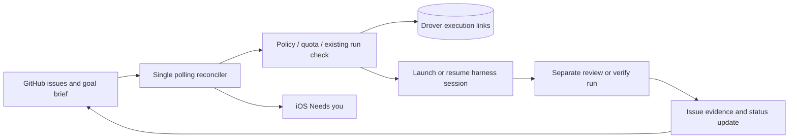
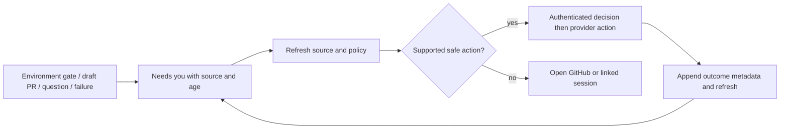

# Drover work queue: SLIM v2

Direction approved October 13, 2026, 15:19 PT. Design only; replaces v1. Target: one user, one workspace, four agent roles, and one orchestrator.

## Product contract

GitHub Issues is the system of record for work in the configured Drover repository and other configured repositories. Goals use a milestone or `goal:2026-w42` label plus a goal brief. Issues hold public acceptance criteria, dependencies, priority and progress; comments replace the ledger. Drover owns execution links, quota-aware routing, and surfacing decisions. It does not mirror issues or maintain a second work queue.

Open/closed is the terminal state. Each open issue has one of `status:queued|running|review|blocked` and an `agent:<name>` label when assigned. Unknown/conflicting labels produce a reconciler diagnostic, not a guessed state. A separate review/verify run checks acceptance before closure; a worker's report or a green health endpoint is insufficient evidence.

October 11-13 delivered three releases and about twenty PRs. The immediate gaps were reconciler notes leaking into chat, an unseen TestFlight environment approval, and a misread health check. Keep the successful execution flow, move routine notes to issues, expose pending decisions, and verify the actual outcome.

## What lives where

| Surface | Owns |
| --- | --- |
| GitHub issues, labels, milestones, comments | Work, goal membership, public criteria/dependencies, status, assignment, progress, evidence links, revision notes and systemic reviews. PRs/checks/environments retain their own authoritative state. |
| Drover control Postgres | External refs linked to harness sessions/PRs/goals, pending agent decisions, and an append-only metadata audit. No copied issue body, comments or status. Provider results are fetched live; any response cache is bounded, disposable and marked stale. |
| Files | Goal briefs, private context, artifacts and policy config. Public issues reference private briefs through opaque authorized refs, never copied content or revealing local paths. Secrets remain in credential stores. |
| iOS | One “Needs you” list, using existing inbox navigation, notification routing and session links. Work browsing/editing stays in GitHub. |

## Minimal data model and tools

Add two small tables through existing control Postgres migrations. Every row carries `workspace_id`, authenticated `actor_principal`, and timestamps; provider identity is workspace-scoped.

- `execution_links`: `id`, external item ref `{provider, repo, number, url}`, external goal ref, `session_id`, optional `pr_ref`, `run_key`, `run_role` (`work` or `verify`), failure count and last progress time. One row per session contribution; unique `(workspace_id, run_key)` and session association prevent accidental link duplicates. Persist a launch intent with a nullable session before calling the harness, then fill the session link. Failed/uncertain intents remain inspectable. No issue-state columns or claim protocol.
- `decision_events`: append-only `id`, item/link ref, event kind, request/source key, action category, options as action codes, actor, outcome, provider operation ID and timestamp. Decision IDs derive from stable provider/request identities; pending agent questions are projections of these events. Store text in the authorized brief/session or a sanitized issue comment, not this audit. Attempts to correct history append events.

Use canonical `HarnessSession.session_id`, `parent_session_id` for delegation and `source_session_id` for resume lineage. Reuse harness `client_session_id` with the persisted run key. Existing registry/daemon state supplies execution status. Goal policy is config referenced by the goal brief, not a new goal table.

Expose shared HTTP/MCP operations: `drover_work_list/get` read through the provider; `drover_work_launch` selects quota/capability routing; `drover_work_link` associates sessions/PRs; `drover_work_update` writes allowed labels/comments to the provider; `drover_work_question/decide` records questions and decisions. Completion requests schedule verification rather than closing directly. Return provider refs, session links and freshness; reuse existing bounded MCP reads and credential checks. The control API owns linking and reconciliation; analytics-hosted MCP is a thin authenticated adapter to it.

## Flows and reconciliation

Poll every two minutes across configured goal/repository scopes, with pagination, conditional requests and rate-limit backoff. Each pass derives unmet actions from live issues plus Drover links: queued work may launch, running work is checked against sessions, review work receives verification, blocked work waits for its stated blocker. Verification success closes the issue; failure returns it to queued for revision or blocked after the retry budget. Repeated scans with no unmet action launch nothing and send no chat note. Changed criteria require another verification run.

Nix is the sole v1 launch coordinator. Jenny, Max and workers use the same scoped tools to report progress, delegate through that coordinator and request decisions. Serialize launches in this one process, check for an existing session/intent, and persist the run key before spawning. On timeout/restart, look up that key before retrying. A running label alone is neither proof of a live worker nor permission to start another. An unreachable/uncertain run blocks relaunch until inspected. This contains ordinary retries without claiming distributed exactly-once execution.

Poll pending GitHub environment approvals, PR review readiness and linked failed sessions as well as issues. Agent questions enter the event projection. Routine findings become issue comments; only unresolved human decisions or systemic failures enter Needs you. Summaries re-read current provider state and recorded decisions before asking anything again.

Reuse `NotificationRouting`, APNs and local notifications with an attention ref, generic lock-screen text, and deduplication by source/request ID. A tap opens the same list focused on the item. Approve/reject or named options appear only when provider permissions, action meaning and current state are known. A draft PR may offer review/open or mark-ready when authorized; never treat “approve” as an implicit merge. Unsupported environment actions open GitHub. Rejection requests revision. Failed items offer inspection and, after required review, retry.

All trusted paired devices in the workspace may decide. Refresh before executing, recheck already-resolved requests, and disable offline decisions. Serialize decisions in the control service; log an intent before an external action and the outcome afterward. If an action times out, inspect provider state before retrying and show uncertainty. This is a small audit flow, not a general mutation-receipt system.

## Policy defaults

All defaults live in versioned per-goal config, referenced by the goal brief. Log policy changes as metadata events and sanitized issue comments where appropriate.

- **Authority:** Nix, Jenny, Max and workers may merge, deploy, spend and delegate within agreed goal/quota. Critical or destructive actions require a human decision: production cutovers, data migrations, deleting data and outward-facing posts. Ambiguous classification blocks for a decision. Tool authorization enforces the policy at the action boundary.
- **Acceptance:** Nix defines and may amend criteria, recording the amendment. A separate review/verify run is sufficient; no mandatory human acceptance or separate verifier credential. Require evidence for the intended behavior, not merely process exit or a health response. The verifier reruns relevant checks against the resulting commit/artifact.
- **Priority/retries:** default normal priority; urgent incidents first, then goal priority and oldest queued work. Start with one attempt plus two retries. After the third failure, stop and write a short systemic review identifying the repeated assumption/process gap. Nix may authorize a bounded new attempt after that review and a changed approach, within policy/quota. Human rejection returns for revision and does not consume a failure attempt by itself.
- **Capacity/quota:** maximum five active workers per goal, including verification runs; five across the workspace initially. Reserve 20% of each provider's available goal quota for verification/recovery. A launch needs estimated cost plus reserve; unknown quota pauses new launches. Route to an eligible provider with headroom without relaxing acceptance or authority.
- **Progress:** flag thirty minutes without substantive progress. An active long tool call gets up to sixty minutes before inspection, extended explicitly for known slow work. Neither stale signal alone kills/restarts a worker. Session liveness is distinct from progress.
- **Window:** running work may finish after expiry. Propose one extension up to 24 hours within unchanged scope/quota, logged by Nix; further extensions or expanded spend/scope need a decision. New launches after expiry require the logged extension.

These are starting settings, not measured optima: the supplied throughput supports retaining up to five workers, while the observed failures favor better attention and verification over tighter timeouts. Review defaults after one goal window.

## Multi-user and managed seams

Define a provider adapter now: `list/get_item`, `set_labels`, `comment`, `close/reopen`, `list_attention`, `inspect_action`, `execute_action`, with explicit capability flags and opaque refs. GitHub is the only implementation in MVP; Linear/Jira are future adapters. No provider-specific issue data becomes Drover's authoritative copy.

Authenticate principals from credentials, never request fields. Scope all links/events, config and provider credentials to `workspace_id`; reject cross-workspace refs. Agent action permissions and human decision permissions differ even when one workspace trusts every paired device. Keep the current MCP transport/auth restrictions.

Support a GitHub App credential configuration path with installation/repository identity and permission capabilities, alongside a repository-scoped personal token for the initial setup. Resolve credentials behind the adapter; managed installations can later use installation tokens without changing item refs or tools. Restricted environment/review actions fall back to provider navigation when unavailable.

Proposed retention: execution links through session retention plus 90 days; decision/event metadata for one year, configurable. Resolved attention is retained as metadata, not question content. Public issues/comments contain no secrets or private context; sanitize before writing, otherwise retain context in private briefs. Audit stores IDs, categories and outcomes only. Removing sensitive content follows a workspace redaction procedure; append a redaction marker and preserve nonsensitive history. GitHub comments are the work ledger but are editable, so the Drover append-only metadata audit records the consequential actions independently.

## Migration and files

Pause the legacy launch writer, snapshot `work-items.json`/`ledger.md`, and build a reviewed mapping to existing issues before creating missing ones. Map known stage variants to the four labels; unresolved mappings stay blocked. Convert `after` to public issue dependencies only after checking meaning. Carry session/PR refs into links and `next` into a sanitized issue comment. Recheck imported “done” evidence before closing.

Import useful ledger entries as sanitized issue comments with stable source markers, checking those markers on reruns. Keep private entries in the local archive. Preserve briefs in files and link opaque authorized refs; extract only public acceptance criteria. Replace `goal-current.md` queue fields with milestone/label refs plus policy/goal brief. Files retain private context, artifacts and runbooks; old JSON/ledger become read-only cutover evidence.

Run the GitHub reconciler in read-only shadow mode and compare all active items, pending approvals and links. Then switch the single coordinator and summaries together. Infrastructure health/soak/reap jobs remain infrastructure tasks. Rollback stops new launches and refreshes provider state before enabling any legacy writer; never overwrite later decisions from an old snapshot.

## Deferred items and triggers

- **Leases, claim epochs and fencing:** add after a double-run incident or before enabling more than one orchestrator. V1 deliberately depends on a single coordinator.
- **Mutation receipts:** add when ambiguous retries cause duplicate external effects or provider inspection cannot resolve outcomes.
- **Separate verifier principals:** add when review independence cannot be maintained by separate runs, or managed users require enforced separation.
- **Webhooks:** add when polling misses the required attention latency or approaches provider rate limits. Polling remains recovery even then.
- **Full OTel tool spans:** add when session links/audit cannot explain incidents or an operational tracing requirement appears. Preserve optional trace correlation IDs now; later propagate request → session → worker → tool parents, exporting allowlisted identity/status metadata without content. No tracing dependency in MVP.

## Phases and risks

MVP target: 2-3 days. Day 1: GitHub adapter, labels/policy, polling reconciler and reviewed migration. Day 2: Postgres links/audit and MCP tools, quota routing, restart recovery and separate verification. Day 3: one iOS Needs-you list with existing notifications and safe decision actions. Keep managed installation provisioning, additional providers and deferred features outside this delivery.

Exit checks: repeated polls do not relaunch; restart resolves a persisted run key; a failed behavioral check cannot close an issue; third failure requires systemic review; an environment approval appears in Needs you; stale/two-device decisions do not repeat a known resolved action; public comments/audit contain no private text.

Risks: labels can drift, polling can lag, a single coordinator can be bypassed, provider permissions vary, and a green check can mislead verification. Diagnose conflicting labels, show refresh age, require all launches through the coordinator, expose capability-based actions, and verify behavior with evidence. Provider or control-store outages pause new launches/decisions without stopping existing runs. The unresolved outcome of a remote operation requires inspection, not automatic retry. The default thresholds and real runtime/approval integrations still need validation during implementation; the underlying October 11-13 artifacts were unavailable, so calibration uses only the supplied facts.
