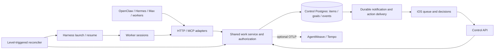
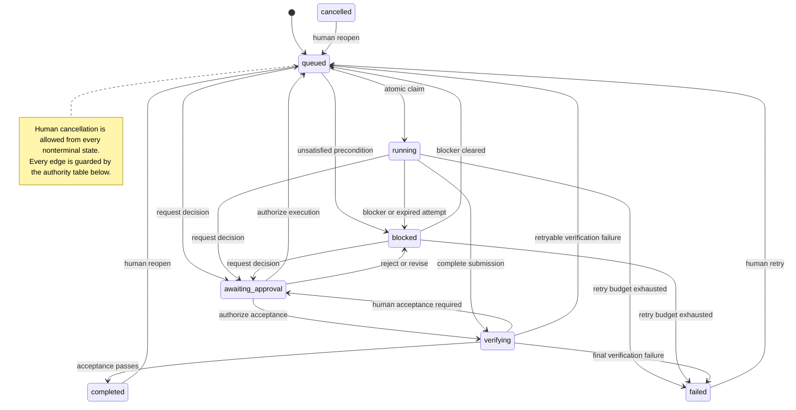

# Drover work queue

Design proposal. Authorized by Arnab on October 12, 2026 at 23:24; implementation is outside this document's scope.

## Product contract

Drover should remember what needs doing, who has authority to do it, what is running, and which decision is pending across agent sessions. The control Postgres becomes the shared source of truth for work and decisions. Files remain useful for briefs and artifacts. A harness session is an execution attempt, not a work item, and a worker saying "done" is evidence to review, not completion.

Today's continuity uses `goal-current.md`, `work-items.json`, an append-only `ledger.md`, briefs, a launcher script, and scheduled checks. The design addresses observed failures directly: typed states prevent `worker`/`working` drift; atomic leases prevent competing claims; durable decisions prevent repeated questions; transactions permit multiple writers; evidence gates prevent false completion. Summaries read current rows and events instead of treating old chat or generated prose as authority.

## Fit with the repository

| Existing surface | Proposed extension |
| --- | --- |
| [`postgres_schema.py`](../../src/drover/server/postgres_schema.py), [`postgres_control_store.py`](../../src/drover/server/postgres_control_store.py) | Add versioned control-schema migrations and a typed work service. Use explicit transactions: the current pool uses autocommit. Queue availability requires a ready Postgres control store; legacy central DuckDB gets an explicit unsupported response. Host-local spools remain unchanged. |
| [`harness/models.py`](../../src/drover/server/harness/models.py), registry and daemon | Link attempts to canonical `session_id`; use `parent_session_id` for delegation and `source_session_id` for resume lineage. Reuse `client_session_id` launch deduplication, then strengthen the concurrent-launch gate as described below. |
| [`continuity_schema.py`](../../src/drover/server/continuity_schema.py) | Existing Factory observer leases/inbox remain specific to Factory. Queue links may reference those runs; queue ownership does not take over Factory execution state. |
| [`control_outbox.py`](../../src/drover/server/control_outbox.py) | Reuse the atomic state/event/delivery-intent pattern, with queue-specific delivery rows. Do not put queue commands in the harness archival exporter. |
| [`web/auth.py`](../../src/drover/server/web/auth.py), [`mcp/server.py`](../../src/drover/server/mcp/server.py), [MCP contract](../mcp.md) | Add explicit queue permissions and shared HTTP/MCP authorization. Existing host/device access is broad; it must not implicitly grant agent approval or unrestricted queue writes. |
| `DroverKit` models/client/stores; `Drover/Screens`; `NotificationRouting`, `PushRegistrar`, `BackgroundRefresh` | Add queue models, client methods, observable store, SwiftUI screens, and item notification routing through the existing app structure. |
| [Optional span integration](../optional-span-integration.md) | Add opt-in outbound instrumentation. Queue serving and audit do not depend on span ingestion, Tempo, or analytics. |

## Data model

Use opaque UUIDs, UTC `timestamptz`, typed API models, and database constraints. `status` is a closed enum in both wire/schema contracts, implemented as checked text to allow additive migrations. Unknown values are rejected, never normalized during normal writes.

| Table | Fields and invariants |
| --- | --- |
| `goals` | `id`, `title`, `status` (`active`, `paused`, `closed`), `window_start`, `window_end`, structured `outcomes` with acceptance checks, versioned `authority_rules`, quota/concurrency limits, reporting cadence, `version`, timestamps. Window end stops new autonomous claims; it does not silently cancel running work. Authority names permitted actions, allowed principals/projects, approval requirements, verifier, and budget bounds. Unmatched actions require human approval. |
| `work_items` | `id`, `title`, `kind` (`task`, `bug`, `research`, `review`, `release`, `epic`), `status`, integer `priority` (lower first), `tags`, `project_key`, optional `repo_owner`/`repo_name`, `goal_id`, optional `epic_id`, `brief_text` or immutable `brief_ref` plus digest, structured `acceptance_criteria` with stable criterion IDs, `owner_agent_id`, `claim_host_id`, `claim_credential_id`, `claim_epoch`, lease-token verifier, `lease_expires_at`, `heartbeat_at`, `attempt_count`, `next_action`, `blocked_reason`, `next_eligible_at`, `version`, timestamps. Exactly one brief source; an epic cannot own itself. Owner assignment does not confer a lease. |
| `work_item_dependencies` | `(item_id, depends_on_id)` primary key and item foreign keys. Reject self-dependency/cycles under a graph-edit transaction lock. All dependencies must be `completed` to claim; cancelled/failed dependencies block rather than count as success. |
| `work_item_attempts` | `(item_id, attempt_no)` unique, `claim_epoch`, agent/host, launch key, state, start/end, evidence refs, failure category, verification result, trace context. Increment count once per accepted claim, not per heartbeat or tool retry. |
| `work_item_links` | Item and optional attempt, type (`session`, `pr`, `issue`, `release`, `artifact`), canonical identifier, role and observed timestamp. Session links reference `harness_sessions`; external links use validated provider IDs/URLs. Preserve every attempt's links; many sessions can contribute to one item. |
| Approval fields and `work_item_approvals` | Item exposes `needs_approval` and current `approval_id`; approval rows retain `question`, stable option IDs/labels with explicit effects, `requested_by/at`, authority version, item action/version being approved, state, chosen option, `decided_by/at`, rationale. Only one pending approval per item. Snapshot changes that alter the approved action supersede the request. Historical decisions remain readable. |
| `work_item_events` | Append-only ledger: `event_id`, `item_id` or `goal_id`, per-aggregate `seq`, actor principal/type/credential ID, event type, before/after status, aggregate version, attempt/approval refs, bounded structured changes/evidence, reason, `occurred_at`, `recorded_at`, correlation and trace/span IDs. Unique aggregate sequence; never edit an event to correct history. Corrections append new events. |

Supporting records: mutation receipts keyed by `(credential_id, idempotency_key)` with request digest and result; action/notification delivery intents keyed by event/action identity. State mutation, ledger append, receipt, and delivery intent commit together. Service roles cannot update/delete ledger rows; database administrators remain in the trust boundary. Briefs and decision text are permissioned product content, never telemetry attributes.

Indexes cover `(status, next_eligible_at, priority, created_at, id)`, active lease expiry, goal/project/owner filters, pending approvals, event ordering, dependencies, and external link lookup. Paginated queue responses include current version and server time; scoped reads enforce the same permissions as writes. Bound briefs, options, evidence and event payloads separately from compact list rows.

## States, authority, and completion

`queued`, `running`, `blocked`, `awaiting_approval`, `verifying`, `completed`, `failed`, `cancelled` are the only item states. Readiness is a predicate over `queued`, dependencies, goal authority/window, capacity and retry time, not another mutable stage. Every transition appends an event.

| Operation / transition | Authorized actor and guard |
| --- | --- |
| Create, edit queued metadata/dependencies, assign owner | Human or agent with `work:write` inside its goal/project authority. Agents cannot expand authority or change acceptance criteria after a claim. Humans may amend them with an audit event and invalidation of affected evidence/approvals. |
| `queued → running` | Eligible agent or scheduler using atomic `claim`; bound identity, satisfied dependencies, active goal, budget and capacity required. |
| `running → blocked/verifying/awaiting_approval` | Current lease holder; reconciler may block an expired/orphaned attempt. Entering any of these states releases the execution lease. Worker activity must cease before requesting approval. |
| `queued/blocked/verifying → awaiting_approval` | Scoped agent/service or human; request captures the precise action, options and approved snapshot. |
| `blocked → queued` | Human or reconciler after the recorded blocker is resolved. Agents may provide evidence but cannot erase unresolved authority gates. |
| `awaiting_approval → queued/verifying/blocked/cancelled` | Human with `work:decide`, matching pending approval ID/version. Options determine the transition. Execution approval permits a new claim; acceptance approval returns to verification. Reject means blocked for revision unless the presented option explicitly cancels. |
| `verifying → completed/queued/failed` | Designated verifier service or human. Verifier applies goal policy and evidence checks; failure consumes retry budget and sets backoff. |
| Active state `→ failed` | Reconciler/verifier for exhausted attempts or permanent error, with reason/evidence. |
| Any nonterminal state `→ cancelled`; terminal `→ queued` | Human only in MVP. Cancellation revokes lease, supersedes pending approvals and requests worker stop. Reopen/retry retains history, increments version and invalidates old acceptance. |
| Change goal authority/window, pause/close goal | Human only. Pause blocks claims and requests running workers to checkpoint; closing requires an explicit disposition for unfinished items. |

No generic `update(status="completed")`. `complete` submits criterion-by-criterion evidence and moves to `verifying`. A successful process exit, merged PR, or transcript claim alone cannot satisfy all criteria. Automated checks verify artifact identities, test/check results, expected commit and any required merge/release state. Independent verifier credentials cannot be held by the submitting worker. Criteria needing judgment route to a durable approval. Human acceptance may explicitly waive a check with a recorded reason. Editing an accepted artifact revokes its verification and requires rechecking.

Approval grants cover an action, scope, and authority version; they do not expand a goal's general authority. Decisions already recorded are returned on retries and included in fresh summaries. Harness `awaiting=approval` remains a session execution signal, separate from a queue decision; cross-link them when they describe the same question.

## Claims, idempotency, and reconciliation

Proposed defaults: five-minute claim TTL, heartbeat every minute, server-bounded TTL of one to ten minutes. Use database time for expiry. Claim selects an eligible row with `FOR UPDATE SKIP LOCKED`, locks shared goal/capacity records, then atomically increments epoch/attempt, assigns the principal/host, issues an opaque lease token and records the event. Competing claims cannot both succeed. An owner/session ID supplied by a caller is never authentication.

Freeze dependency and acceptance edits during claim under the same transactional guards. A scheduler may claim on behalf of a preauthorized worker principal and provision its attempt credential through the trusted launch channel; record both scheduler actor and execution holder. This is explicit delegation, not a caller-selected identity. Encrypt secret-bearing claim receipts at rest so retries can recover the lease token without placing it in audit payloads.

Heartbeat and worker mutations require the token, epoch, same authenticated principal, and an unexpired lease. Heartbeat extends only a live lease, cannot resurrect one, and does not imply progress. Progress age is tracked separately. Metadata edits use compare-and-swap `expected_version`; heartbeat maintains a separate lease revision so it does not invalidate a human editing a title. Approval decisions compare approval revision and the approved action snapshot. Return `409` with current state for conflicts, `403` for authority failures, and `503` for unavailable control storage.

All mutations accept an idempotency key. A duplicate key and identical request returns the committed result; different content is a conflict. Keep receipt identity at least through the item's terminal retention window, including failed launch intents. Recheck credential revocation and read scope before returning a cached response. Launch intent uses deterministic `(item_id, attempt_no)` identity, bound to one host. Send it as harness `client_session_id`, recording `parent_session_id` from the orchestrator. The existing pre-spawn lookup and registry unique index help retries but do not alone prove concurrent spawn exclusion. MVP must serialize/reserve each launch key before spawning and verify this with concurrent launches.

The reconciler repeatedly asks what current state requires, rather than responding only to a file change. Run a bounded scan every 30 seconds, with commit notifications as optional wakeups. Multiple instances use per-action claims and the same transactional guards. It:

1. Promotes resolved blockers and selects eligible work within goal quota, concurrency and provider headroom. Quota outages block launches, not queue reads or decisions.
2. Claims work and persists launch intent before any external side effect. Recovers timed-out launches by querying the recorded host/key, not launching on another host blindly.
3. Checks leases and linked session state independently. On expiry, fences the worker, records the expired attempt, and blocks until the old session is confirmed stopped or isolated. Only then requeues with bounded exponential backoff. An unreachable host cannot be assumed dead. Uncertain launch outcomes also remain blocked pending recovery.
4. Processes verification, approvals, retries and notifications from persisted state. Delivery is at least once with deduplication. Repeated scans with no unmet action do no work and launch no agent turn.
5. Generates summaries from current rows plus an event cursor, noting pending decisions and already-decided outcomes. Rechecks pending approval IDs immediately before sending a decision prompt. Goal reports retain their source versions/cursor and generation time.

Leases fence control mutations, not arbitrary shell commands. Workers check authority before irreversible actions; revocation propagates stop/checkpoint requests. MVP cannot safely automate cross-host failover of an uncertain attempt. Claim retry does not promise exactly-once external effects: each supported effect also needs its own idempotency/recovery contract. External calls and LLM work occur outside database transactions.

Releasing a lease for blocking or approval also requires a recorded worker checkpoint/stop before a new execution claim. If that acknowledgement is missing, approval may be recorded but launch readiness remains blocked. Late evidence from a fenced attempt is historical input for a verifier, never authority to mutate the active attempt.

## API, MCP, and principals

The control API owns the work service and reconciler. In split roles, current MCP is analytics-owned; queue MCP tools proxy through a new bounded authenticated internal route to the control API, with verified actor context, rather than owning another queue loop or depending on lake reads. Reject caller-forged actor headers. Queue-specific MCP authorization must check the underlying operation, not the existing generic `/mcp/mutate` permission. If analytics is unavailable, agents can use the same HTTP contract directly. Preserve the current loopback MCP transport restriction and use a protected tunnel for remote clients.

| HTTP under `/work` | MCP tool | Result / key arguments |
| --- | --- | --- |
| `GET /items`, `GET /items/{id}`, `GET /items/{id}/events` | `drover_work_list`, `drover_work_get`, `drover_work_events` | Filter status/goal/project/owner/tag, cursor pagination; compact list plus explicit detail and bounded event reads. |
| `POST /items` | `drover_work_create` | Brief, criteria, goal/deps and initial assignment; returns ID/version. |
| `POST /items/{id}/claim` or `/claims` for next eligible | `drover_work_claim` | Item or eligible filters, TTL, execution target; returns attempt, epoch, token, expiry and effective authority. |
| `POST /items/{id}/heartbeat` | `drover_work_heartbeat` | Token/epoch; returns server expiry. |
| `PATCH /items/{id}` | `drover_work_update` | Versioned metadata, links, progress or permitted block/release operation. No arbitrary state bypass. |
| `POST /items/{id}/complete` | `drover_work_complete` | Lease, expected version, criterion evidence refs; returns verification state. |
| `POST /items/{id}/approvals` | `drover_work_request_approval` | Question, options with action effects and action snapshot; returns approval ID/version. |
| `POST /items/{id}/approvals/{approval_id}/decision` | `drover_work_decide` | Expected approval version, option ID, rationale; actor/time server-derived. |
| `POST /items/{id}/cancel`, `/reopen`; `GET/POST/PATCH /goals` | Human API; later administrative tools | Audited lifecycle and goal authority management. |

Mutation results contain item state/version, event ID and attempt/approval IDs. Queue reads reuse MCP admission/deadline/byte ceilings and truncation flags; oversized briefs use authorized detail/artifact fetching instead of silent truncation of acceptance criteria. Events support a resumable cursor for polling; streaming can follow later.

Add an `agent` credential scope with server-side grants: `work:read`, `work:write`, `work:claim`, `work:heartbeat`, `work:submit`, `work:request_approval`, `work:verify`, `work:decide`, and `work:admin`, constrained by host, principal, project/goal and optionally item/attempt. Scope checking precedes every operation and receipt replay. Profile/preflight credentials receive none. Existing host credentials may register execution links for their own host, but queue grants are explicit. Trusted paired human devices receive read/write/decide/admin for their workspace; agent credentials cannot receive decide/admin in MVP. An enabled legacy operator credential remains explicit operator authority, never a distributed worker token. Revocation invalidates claims; plaintext tokens and lease tokens never enter ledger or telemetry.

| Client | Workflow and default authority |
| --- | --- |
| Nix (OpenClaw) | Goal-scoped coordinator reads/events, creates/updates items, requests decisions, and delegates launch intents through the scheduler. Replace file polling with the shared service. The existing continuity owner plugin is Factory-specific, so extend integration deliberately rather than silently changing its authority. |
| Jenny (Hermes) | Separate principal with the same scoped contract; claim assigned work, heartbeat, attach evidence and request approval. Does not share Nix's token. |
| Max | Uses queue reads for startup context and decisions; claims scoped work and links native or harness sessions explicitly. No assumption about a particular Max runtime. |
| Drover workers | Short-lived attempt credentials limited to their item/host; heartbeat, progress, links, evidence submission and approval requests. Delegation requires an explicit coordinator grant; workers cannot verify their own completion. |

## iOS and notifications

Add a Queue destination from the existing session inbox navigation. Default sections: Needs you, Running, Ready, Blocked; filters for goal/project/owner and an archive for terminal work. Rows show priority, state, agent, lease/progress age, dependency count and linked session activity. Stale/offline state is visible; cached data never enables a decision without refresh.

Item detail shows brief, acceptance checks/evidence, dependencies, attempt/session/PR links, current question/options, recorded decision and event timeline. Approve/reject buttons submit explicit option IDs; nonbinary questions present their named options. Refresh approval/version before submission, disable while pending, and show a conflicting decision rather than overwriting it. Reject can capture a reason. Decisions require authenticated network access and are never queued offline. Human cancellation/reopen actions use the same service guards.

Extend existing APNs/local-notifier routing with `work_item_id` and `approval_id`, keeping cold-launch navigation behavior. Notify once per pending approval revision and on exhausted/uncertain attempts; deduplicate local/push delivery by event ID. Lock-screen text is generic, with no brief/question content. A notification tap fetches live detail; if another device already decided, show the recorded decision. MVP buttons live in detail, avoiding stale lock-screen approval actions. Reporting schedules and notification preferences belong to goal/device settings.

## GitHub, files, and migration

GitHub issues/PRs/releases are linked, not mirrored. Store canonical refs and the last observed check/merge/release facts needed as evidence. Webhook delivery IDs deduplicate observations; scoped polling recovers missed deliveries. GitHub remains authoritative for its objects; a closed issue or merged PR does not automatically finish unrelated criteria. Queue decisions stay in Drover. Creating/commenting/merging GitHub objects remains a separately authorized action.

1. Dry-run a sanitized import of `work-items.json`, `goal-current.md` and `ledger.md`; report counts, unresolved refs, duplicate identities, dependency cycles and unknown stages. Explicitly map known `worker`/`working` variants; quarantine unmapped stages. Parse `after` as dependencies only where source meaning is unambiguous, and preserve `next` as next action.
2. Human-review the extracted goal outcomes, authority, quota and reporting settings. Import briefs by immutable ref/digest or text. Map `sid`, branch and PR to links; unresolved sessions remain external legacy refs until matched. Imported active items start blocked for reconciliation, with no fabricated live leases. Imported "done" items need evidence review before `completed`.
3. Import ledger entries as provenance-tagged legacy events with original order/source digest and separate recorded time. Preserve ambiguous free text as historical content, not executable transitions or verified decisions. Stable source IDs/digests make reruns idempotent. Decisions found only in chat require human attestation or remain open.
4. Pause legacy writers/launch cron, capture a final immutable snapshot, apply the final import delta and compare every item. Run the new reconciler in read-only shadow mode before enabling claims. Switch agent clients and summaries together; never allow files and Postgres to be concurrent authorities.
5. Keep source files read-only as migration evidence and generate optional Markdown/JSON exports from Postgres. Rollback pauses claims, fences/stops active attempts and exports current state before re-enabling any legacy writer. Do not restore an old queue snapshot over newer human decisions.

Files retain briefs, repository plans, large evidence/artifacts and runbooks; scripts become clients. `goal-current.md`, `work-items.json` and `ledger.md` become optional human-readable exports, not writable state. Secrets stay in credential stores. Health/soak/reap schedules continue for infrastructure and session retention; the reconciler replaces queue change-trigger turns, and morning/evening reports read the table. Session reaping must preserve linked audit/evidence references or mark artifact availability explicitly.

## Observability hook

Emit opt-in OpenTelemetry spans at HTTP/MCP request boundaries, claim/transition/verification/decision operations, harness launch/session attempts, worker execution, and agent tool calls. Carry validated W3C `traceparent`/`tracestate` through internal calls, launch metadata and worker adapters. Persist trace/span IDs with attempts/events and tool-call parent IDs so AgentWeave/Tempo can reconstruct request → session → worker → tool. Harness delegation IDs remain the durable source of session parentage.

Use real parent contexts for nested synchronous work; store the originating request context for deferred launches. Emit short operation spans and worker-attempt spans rather than an unbounded span held open for an entire goal. A resumed session or new retry can start a new trace with a span link to its prior attempt and origin; tools parent to the active worker/turn span. If a runtime cannot propagate tool context, report instrumentation coverage explicitly instead of inventing parentage from timestamps.

Attribute allowlist: opaque item/goal/attempt/session IDs, host/agent principal IDs, event/operation/tool name, enum status/kind/outcome, claim epoch, retry count, approval ID, duration and sanitized error category. Keep IDs out of metric labels. No titles, briefs, question/options, prompts, tool arguments/results, repository paths/URLs, command text, credentials or user content. Strip baggage and unsafe exception text. Opaque identity metadata still requires access control and retention limits. Optional collector/exporter is bounded and fail-open; span loss never loses a queue event. Configure outbound tracing separately from the legacy span-ingestion flag.

Operational metrics: queue depth/oldest age by state, claim conflicts, lease expirations, progress staleness, uncertain launches, retry exhaustion, pending approval age, verification rejection rate, reconciliation lag, notification delivery lag and exporter drops. Structured logs include event/correlation IDs and sanitized categories. Health exposes last successful reconcile and oldest overdue action. Alert on persistent overdue work, not every missed heartbeat.

## Phases and validation

MVP target: about one engineering week, contingent on keeping one workspace, Postgres-only queue storage, polling, and a simple verifier. This document ships no implementation.

| Phase | Deliverable and exit condition |
| --- | --- |
| Days 1–2 | Schema/service, transactional events/receipts, credentials and HTTP/MCP core operations. Validate concurrent claims, fencing after expiry/revocation, state/authority rejection, heartbeat/edit races and transaction rollback. |
| Days 3–4 | Level-triggered reconciler, durable launch intents, strengthened harness launch deduplication, backoff and evidence verification. Validate crashes before/after launch, concurrent launch retries, unreachable host handling, duplicate completion, goal capacity races and worker false-done rejection. Pilot one coordinator and one worker; HTTP adapters suffice for other runtimes initially. |
| Days 5–7 | iOS queue/detail/decisions and existing notification routing; import dry-run/cutover tooling; minimal optional lifecycle/tool tracing. Validate two-device decision races, stale notifications, cold launch, offline decisions, import rerun parity and a request/session/worker/tool trace with no content attributes. Enable claims only after shadow comparison. |
| Follow-up | Full OpenClaw/Hermes/Max runtime adapters and tool-span coverage, richer independent verifiers, GitHub webhooks, streaming, bulk edits, archival policy and multi-workspace grants. |

MVP acceptance: one launch for a contested item; no automatic relaunch while an old attempt is uncertain; no `completed` without recorded acceptance; a decided question never remains pending; every successful mutation has an atomic audit event; summaries recover after restart from current state. Tracing disabled and analytics unavailable must leave control HTTP reads, decisions and reconciliation usable.

## Risks and questions for Arnab

Main risks are external effects continuing after lease loss, brittle evidence checks, overly broad inherited credentials, and a one-week scope spanning server, adapters and iOS. Fencing plus blocked recovery contains uncertain execution; independent verification contains false completion; explicit scoped grants contain authority drift. Missed notifications are recoverable from pending state. Database outage stops mutations/launches, preserves cached reads, and requires workers to checkpoint before lease expiry. Backups must include queue, receipts, events and decisions together. Imports must avoid treating historical prose as current authorization.

Questions for Arnab before implementation defaults are finalized:

- Which actions may Nix/Jenny/Max perform autonomously, and which always require a decision, especially merge, deployment, spend and cross-agent delegation?
- Is a separate verifier principal enough for MVP, or should code/release completion always require human acceptance? Who defines and may amend acceptance criteria?
- Should rejection normally block for revision or cancel? Should expired goal windows permit running attempts to finish, or request a checkpoint?
- What default priority, retry budget, per-goal concurrency, quota reserve and stale-progress threshold should apply? Are the proposed lease defaults suitable for long tool calls?
- Is one workspace with all trusted paired devices able to decide sufficient initially? What retention/redaction rules apply to briefs, decisions and audit events?
- Is the one-week MVP scope acceptable with basic runtime HTTP adapters and GitHub links, leaving full webhook and tool-span coverage to follow-up?
