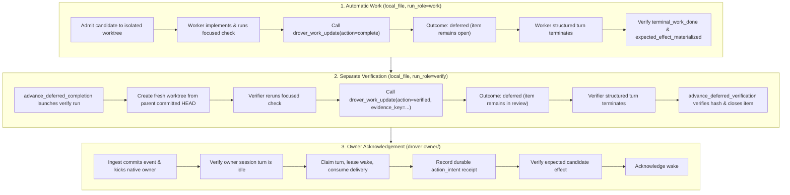

# Verified Event-Path and Automatic Flow Boundaries

This operational reference documents the verified boundaries of the Drover
work coordinator, hub-native continuity owner, and external agent integrations,
reflecting the accepted implementation delivered through #924, #979, and
subsequent accepted commits (`fddcc986`).

The opt-in [GitHub acceptance pilot](github-acceptance-pilot.md) adds a
provider-resolved coordinator gate for explicitly configured issues. It does
not extend the local-file native chain or upgrade historical acceptance proof;
its installed/live acceptance remains a separate owner verification gate.

## 1. Automatic Work -> Separate Verification -> Owner Acknowledgement Boundaries

The multi-stage progression from automatic worker execution to separate
verification and hub-native owner acknowledgement is explicitly scoped to
**configured `local_file` native-owner canary goals** (e.g., #924/#848 canary
fixtures). Real GitHub-backed workloads operate under separate coordinator
boundaries described in Section 2.



### Stage 1: Automatic Work (`run_role="work"`)

1. **Admission & Worktree Allocation**: `QueueExecutionWorker` and
   `WorkService.launch_candidate` dispatch the work item to `drover-harnessd`
   in an assigned, isolated session worktree.
2. **Implementation & Request**: The worker implements the assigned task, runs
   its focused check, and requests completion via
   `drover_work_update(action=complete)`.
3. **Deferred Completion**: In `WorkService.update`, completion requests return
   `{"outcome": "deferred"}`. The work item is **not** closed, and the worker
   cannot self-accept. While the structured turn remains active on the host, the
   queue refuses to advance completion.
4. **Terminal Work Verification**: After the worker's turn finishes,
   `HarnessBridge.terminal_work_done(run_key)` and
   `HarnessBridge.expected_effect_materialized(run_key, artifact)` must both
   evaluate to `True` before the queue reconciles completion.

### Stage 2: Separate Verification (`run_role="verify"`)

1. **Launch from Parent HEAD**: `QueueExecutionWorker.process_once` invokes
   `WorkService.advance_deferred_completion` (scoped to `local_file` scopes with
   hub-signed `committed_provenance`). It sets the item to `status:review` and
   launches a separate verification run. The verification session is created in
   a fresh, isolated Git worktree (`create_session_worktree`) checked out at the
   parent worker branch's committed `HEAD`. Ignored files, untracked artifacts,
   and mutable scratch from the worker worktree are inaccessible to the
   verifier.
2. **Verifier Contract**: The verifier only inspects committed parent files and
   reruns the stated focused check. A verifier is strictly prohibited from
   calling `drover_work_update(action=complete)` (enforced in `HarnessBridge` and
   `WorkService`).
3. **Evidence Reporting**: The verifier reports check evidence with
   `drover_work_update(action=verified, evidence_key=..., behavioral_passed=True, checks_rerun=True)`.
4. **Deferred Verification**: In `WorkService.update`, the verification report
   returns `{"outcome": "deferred"}`. The verifier cannot close the item while
   its turn is running.
5. **Terminal Verification Acceptance**: Only after the exact verifier structured
   turn terminates successfully does `QueueExecutionWorker.process_once` project
   `verify_candidate` and call `WorkService.advance_deferred_verification`. This
   validates that the request hash has not drifted against the current issue
   body, marks the work item `status:closed`, and appends the `verified` outcome
   event in `decision_events`.

### Stage 3: Hub-Native Owner Acknowledgement

1. **Ingest & Wake**: Central event ingest commits structured events and kicks
   `NativeOwnerRunner._process_run`.
2. **Idle Host Guard**: `NativeOwnerRunner` checks
   `_owner_session_turn_idle(session_id)` to ensure the reusable owner session
   has no turn in flight before attempting to consume, avoiding failed delivery
   attempts on an occupied session.
3. **Claim, Lease & Consume**: The native owner claims one turn in
   `continuity_owner_turn_claims`, leases the wake, and consumes the delivery
   through `/harness/factory-observer/continuity`.
4. **Action Intent Receipt**: Before performing an external action, the owner
   durably writes an `action_intent` receipt keyed by
   `(wake_id, action_fingerprint)` and verifies the candidate's expected effect
   artifact.
5. **Wake Acknowledgement**: The owner explicitly acknowledges the delivery
   wake (`acknowledge`).

### Boundary Invariants

- **Worker completion != verifier acceptance**: A worker's request for
  completion only initiates the review transition; it does not close the task.
- **Verifier report != immediate closure**: A verifier's report returns deferred;
  closure requires successful termination of the verifier's exact structured
  turn.
- **Verifier acceptance != owner acknowledgement**: Verification settles the
  work item; owner acknowledgement settles the continuity wake outbox record.
  Neither substitutes for the other.

## 2. Real GitHub Coordinator Ingress vs. Local-File Proof

Drover differentiates between proven local-file canary mechanics and real
GitHub-backed coordinator workloads:

| Dimension | `candidate_source: "local_file"` | `candidate_source: "github"` |
| --- | --- | --- |
| **System of Record** | Local JSON manifest file (`local_candidates_path`) | GitHub Issues in configured repository |
| **Ingress Path** | `LocalCandidateProvider` validates local schema | `GitHubProvider` REST adapter / webhook receiver |
| **Launch Bindings** | Hub signs `committed_provenance`, `authority_scope`, `m2_ack_pending` into binding | Work-coordinator binding with goal profile and authorized owner |
| **Multi-Stage Deferred Verifier** | Proven in canary fixtures (`advance_deferred_completion` & `advance_deferred_verification`) | Scoped to local-file goals; not part of GitHub worker dispatch |
| **Effect Attestation** | Session-relative `local-file:` artifacts verified by `drover-harnessd` | Remote branch commits and PR head SHAs |
| **Implementation Scope** | Hub-native owner continuity loop (`drover:owner/<goal>`) | Webhook ingestion, timeline facts, CI rollups, guarded draft PRs |
| **Observed Live Evidence** | M1 unattended jobs, M2 restart recovery, M3 committed provenance & overlap | Automatic queue admission and tool/session links proven for #980 and #783; end-to-end owner completion **unproven** |

### Live Verification Evidence and Limitations on Real GitHub Runs

Observation of real GitHub workloads (#980 and #783) demonstrates the following
exact capability boundary:

1. **Successful Automatic Admission & Worker Activity**:
   - `WorkService` and `QueueExecutionWorker` successfully admitted GitHub issues
     #980 under goal `continuity-soak-819` and #783 under goal
     `continuity-proof-784`.
   - Workers were launched into assigned, isolated worktrees with appropriate
     tool/session linkages.
   - Worker turn execution, tool use, and commit-only session actions succeeded.
2. **Current OpenClaw Catalog Limitation**:
   - The current effective OpenClaw tool catalog does **not** expose native owner
     `lease`, `consume`, or `acknowledge` tools to external owner sessions.
   - In both live GitHub runs, run-level continuity reports:
     - `authorized_owner_id = "agent:coder:main"`
     - `state = "owner_lease_required"`
     - `owner = null`
     - `owner_epoch = 0`
     - `pending events = ["worker_started"]`
     - `acknowledged = false`
3. **No Manufactured Fallback**:
   - No first-class scheduler handler is available to bridge this gap, and no
     manual or simulated acknowledgement fallback is manufactured.
   - Consequently, **end-to-end GitHub event-to-owner completion is NOT proven**.
   - GitHub workers remain strictly commit-only, and the root integration owner
     independently reviews and publishes PRs.

### Real GitHub Implementation Mechanics

For repositories configured with GitHub integration, the coordinator implements:

- **Webhook Ingestion**: `GitHubWebhookReceiver` verifies `X-Hub-Signature-256`
  HMAC-SHA256 signatures and deduplicates deliveries using `X-GitHub-Delivery`.
- **Event Tracking**: `GitHubWebhookWorker` processes pull request events
  (`opened`, `synchronize`, `ready_for_review`, `closed`), review submissions,
  push events, deployment statuses, and CI suite/run completions.
- **CI Exact-Head Rollup**: Evaluates CI conclusions against the item's
  authoritative `head_sha` via live GitHub checks API queries.
- **Guarded Draft PR Creation**: When `item.publish` is enabled and a worker
  finishes, `WorkItemRuleWorker` checks that the remote branch exists and matches
  the exact commit SHA before opening a draft PR.
- **Guarded Auto-Merge**: When `item.auto_merge` is enabled and exact-head CI is
  green, squash-merging proceeds only if `automation_gate == "none"`.

**Explicit Limits**: Real GitHub integration does not provide automated
multi-stage verifier worktree chaining or automated public release creation.
Claims of unproven GitHub auto-publishing or release support are strictly
prohibited.

## 3. Approval and Commit-Only Publication Boundaries

Authority scopes enforce strict limits on worker and coordinator capabilities:

- **`implementation`**: Strictly **commit-only**. Workers operate in assigned
  isolated worktrees and create commits on session branches. Pushing branches,
  opening pull requests, merging, deploying, or publishing releases are hard
  stops.
- **`integration`**: Review and PR preparation only. The integration owner can
  inspect PRs, review CI rollups, and manage branch updates; merge or deployment
  requires explicit authorization.
- **`deployment`**: Any deployment action produces an unauthorized
  `request_explicit_approval` delivery in continuity. The endpoint refuses
  automatic acknowledgement (`ContinuityApprovalBlocked`). The wake remains
  pending until an authorized human or policy-gated decision resolves it.

### Publication and Policy Gates

1. **Commit vs. Push**: A worker's completion produces local session commits
   only. Pushing to a remote repository requires explicit integration
   authority.
2. **Draft PR Publication**: Opening a draft PR requires a verified remote
   branch head matching the target commit SHA and explicit policy configuration
   (`item.publish: true`).
3. **Merge Gate**: Merging to `main` requires exact-head green CI and no
   unanswered automation gates (`automation_gate: "none"`).
4. **Configured Hard Stops**: Critical operations - production state/config
   changes, gateway restarts, data deletion, financial transactions, and public
   release signing - remain governed by explicit authorization and policy gates
   and cannot be automated without authorized credentials and scope.

## 4. Available Event and Status Visibility

Operational visibility into the continuity and work-queue subsystem is available
across multiple interfaces:

### Authenticated HTTP Endpoint (`GET /continuity/status`)

Accessible on the hub API listener (default port `7080`) requiring a bound
coordinator bearer credential.

Illustrative schema example:

```json
{
  "version": 1,
  "pending_wakes": {
    "total": 0,
    "under_2m": 0,
    "between_2m_and_10m": 0,
    "over_10m": 0
  },
  "active_leases": [],
  "idle_undeclared_sessions": 0,
  "redelivered_wakes_count": 0,
  "native_owner": {
    "active_turn_claims": [],
    "attempts": 0,
    "dead_lettered_wakes": {"count": 0, "oldest_age_seconds": 0},
    "incomplete_receipts": []
  },
  "active_alerts": []
}
```

### Run-Level Continuity vs. Aggregate Status

There is an important operational distinction between the aggregate
`/continuity/status` read model and run-level continuity queries:

- **Aggregate `/continuity/status`**: In live measurements, the aggregate read
  reported zero pending wakes (`pending_wakes.total: 0`) and empty active leases
  (`active_leases: []`) with an aggregate watermark timestamp of `20:07:14Z`,
  predating the active ~20:19Z launches.
- **Run-Level Continuity (`/harness/factory-observer/continuity?run_id=...`)**:
  Provides the authoritative per-run projection. In the live #980 and #783 runs,
  this endpoint showed:
  - `authorized_owner_id = "agent:coder:main"`
  - `state = "owner_lease_required"`
  - `owner = null`
  - `owner_epoch = 0`
  - Pending `worker_started` observation with no ACK.
- **Observed Difference**: The underlying cause for this discrepancy between
  the aggregate read and individual run continuity state is not independently
  established; the observed behavior demonstrates that an aggregate status read
  showing zero pending wakes cannot be assumed to prove that an active run has
  settled or that its owner delivered an ACK. Operators and verifiers must
  inspect the specific run's continuity endpoint rather than inferring run
  health from the aggregate model.

### Model Context Protocol (MCP) Read Tool

AI agents and assistants can query `drover_continuity_status` to receive the
structured operational status without direct database access.

### Prometheus Metrics (`/metrics`)

The Prometheus exporter includes continuity health gauges:

- `drover_continuity_pending_wakes{age_bucket="under_2m|2m_to_10m|over_10m"}`:
  Count of unconsumed continuity wakes.
- `drover_continuity_dead_letter`: Count of exhausted inbox deliveries.
- `drover_continuity_stuck_owner_turn`: Count of active owner claims exceeding
  deadline.

### Pipeline Observatory Dashboard

`deploy/grafana/drover-pipeline-observatory.json` provides the "Continuity Health
& Latency" dashboard row displaying:

- Pending Wakes by Age
- Wake-to-Consume & Consume-to-Ack Latency
- Active Owner Leases & Epochs
- Attributed Continuity Alerts

### Durable Audit & Rule Events

- `decision_events`: Records immutable intent and outcome records for work
  actions (`complete`, `verify`, `status_change`).
- `work_item_events`: Tracks timeline events including webhook receipts, CI
  rollups, and orchestrator wakes.
- `NativeOwnerRunner.observability()`: Returns recent dispatch execution state
  (`state`, `at`, `dispatched`, `runs`).

## 5. Baseline Disclosures & Operational Considerations

- **Disclosed Baseline Test Result (Combined Scoped Suite)**:
  - Running the combined scoped observability and metrics command:
    ```sh
    uv run --extra dev pytest -q tests/test_continuity_observability.py tests/test_metrics.py tests/test_idle_undeclared_continuity.py tests/test_runtime_observability.py
    ```
    yielded 219 passed, 1 failed (`tests/test_metrics.py::test_metrics_collector_marks_stale_harness_hosts`).
  - Observed root evidence: an observed stale/offline discrepancy in a
    timezone-sensitive fixture (`test_metrics_collector_marks_stale_harness_hosts`),
    where a 5-minute heartbeat age evaluated as `offline` (>600s) instead of
    `stale` under host/database timezone differences. Preserved as explicit
    evidence and not changed within this documentation task.
- **Listener Availability Diagnostics**: Connection failures (e.g.,
  `[Errno 111] Connection refused` on port 7080) indicate that the hub process
  is stopped or not bound to the queried network interface; they do not indicate
  an internal error in the continuity status projection itself.
- **Privacy & Redaction Boundary**: Operations documentation and public evidence
  must never include private host addresses, bearer tokens, or internal incident
  history.
